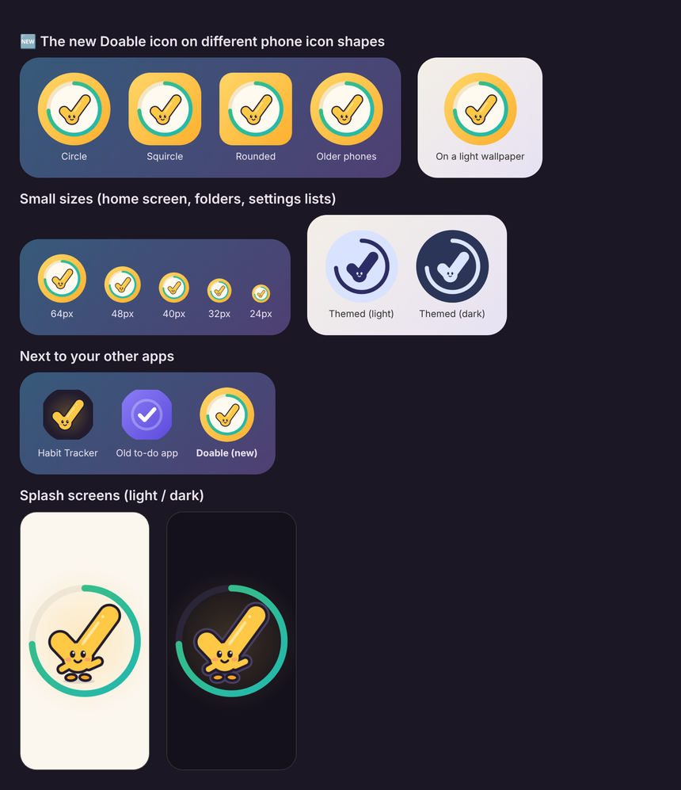
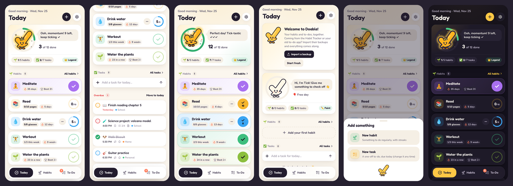
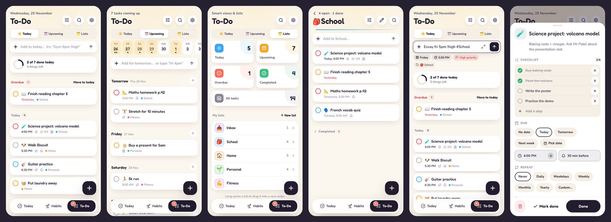

# ✅ Doable: habits + to-dos, with Tick

**One free, offline Android app for your habits AND your to-do list.** Doable merges the **Habit Tracker** (with Tick the mascot) and the old to-do app into one app with one design, one place for your data, one backup file and reminders for both. No ads, no account, no subscription. Everything stays on your phone.





## 📲 Install on your Android phone

**Download link (always the newest version):**
https://github.com/tobyhome12345-commits/To-do-and-habit-merge/releases/latest/download/Doable.apk

1. Open the link above in **Chrome** on your phone. `Doable.apk` downloads.
2. Tap the download notification, or open **Files → Downloads → Doable.apk**.
3. If Android says *"For your security, your phone isn't allowed to install unknown apps from this source"*, tap **Settings**, turn on **Allow from this source**, then go back.
4. Tap **Install**. If Google Play Protect warns about an unknown app, tap **More details → Install anyway** (it says this for any app that isn't from the Play Store).
5. Open **Doable** 🎉 When you set your first reminder, tap **Allow** so Doable can send notifications.

**Already have Tickday?** Doable *is* Tickday with a new name and icon: installing `Doable.apk` updates it in place and keeps all your habits, tasks and settings. (It installs next to the Habit Tracker and the old to-do app, never over them.)

**Updating:** open the same link again and install. It installs over the old version and **keeps all your habits and tasks**, because every build is signed with the same key.

### 🚚 Bring your old data across

Android keeps each app's data private, so Doable can't read the old apps directly. Use backups instead:

1. In **Habit Tracker**: Settings → **Export**. Save the file (Drive, Files…).
2. In the **old to-do app**: Settings → **Export backup**. Save that file too.
3. In **Doable**: tap **Import a backup** on the welcome card (or ⚙️ Settings → **Import backup**), pick a file and choose **Merge**. Do it once for each file.

Habit Tracker files only touch your habits, and old to-do files only touch your tasks. Your theme and colours stay as they are. Doable keeps a safety copy before every import (Settings → **Undo last import or reset**).

## ✨ What's inside

**Today (home)**: today's habits and today's tasks together. Tick looks at your whole day (habits + tasks), with one progress ring, his mood, cheeky messages and confetti when everything's done. You also get quick-add for tasks, overdue tasks with **Move to today**, and a **+** button for a new habit or task.

**🌱 Habits** (everything from the Habit Tracker):
- Habits / Calendar / Stats switch
- Counted goals (💧 8 glasses), flexible schedules (every day, certain days, every X days, X times a week), time of day
- Streaks that understand schedules, 🏆 best streaks, milestone celebrations, Tick's five levels
- Notes, pause, 🏖️ vacation mode, archive, hold-and-drag to reorder, Note/Undo after a check-off
- **New:** a daily **reminder** per habit (the Habit Tracker's reminders were removed because they didn't work; Doable uses the reliable reminder engine from the to-do app)


**✅ To-Do** (everything from the old to-do app):
- Today / Upcoming / Lists switch, plus list pages, smart views (Overdue, Completed, All) and search with filters
- Quick-add that understands `tomorrow 5pm`, `fri`, `!high`, `#School`, `every mon`…
- Subtasks, notes, priorities, emoji, repeating tasks, real reminders with ✓ Done and Snooze
- The self-drawing checkmark with confetti, undo, drag to reorder, sort and filter



**⚙️ Settings** (one page for everything, behind the gear): theme (auto/light/dark), accent colour (Classic, presets including the old to-do app's violet, or any custom colour, contrast-checked), week start, reduce motion, haptics, habit and task reminder switches, default task reminder, vacation mode, archived habits, export, import, undo last import, and reset (habits, tasks or both).


## 🔔 Reminders

Habit and task reminders are real Android notifications, scheduled by the system at the exact minute (even when Doable is closed), with **✓ Done** and **Snooze 10 min** buttons. Habit reminders only fire on days the habit is due, and stay quiet once it's done, paused or on vacation. They survive restarts and reboots. Try **Settings → Send a test notification**.


## 🏗️ How it's built

- **Web app** (React 19 + TypeScript + Vite) wrapped with **Capacitor 8** into a native Android app.
- **One design system** ("Garden notebook" from the Habit Tracker): Fredoka + Nunito fonts bundled offline, warm paper by day, night garden in dark mode, Tick everywhere.
- **One storage document** with a `version` field and step-by-step migrations. Habits and tasks are kept separately inside it, and settings are shared.
- **One reminder engine** for habits and tasks, with separate notification id ranges so they can never collide.
- **GitHub Actions** (`.github/workflows/android.yml`) runs the tests, builds and signs the APK, and publishes it to GitHub Releases on every push.

The details (data model, migrations, backups, reminders) are in **[docs/ARCHITECTURE.md](docs/ARCHITECTURE.md)**.

### Working on it

```bash
npm install
npm run dev          # open http://localhost:5173/?demo=1 for sample data (?demo=done, ?demo=new)
npm test             # 174 unit tests (both old apps' tests + migrations, backups, reminders)
npm run build
npm run assets       # re-render the app icon, splash screens and favicon
npx cap sync android
```

### ⚠️ The signing key and app id

`android/app/tickday-release.jks` and `android/keystore.properties` are committed **on purpose**, so GitHub Actions signs every build with the same key. **Never delete or regenerate them.** The app id stays `com.tickday.app` (from when the app was called Tickday) for the same reason: changing either one would stop updates installing over the app on your phone. If the key changes, Android refuses to install updates over the existing app, and you'd have to uninstall it (export a backup first!). Also, don't rename the workflow file, because its run number is the app's version code.
